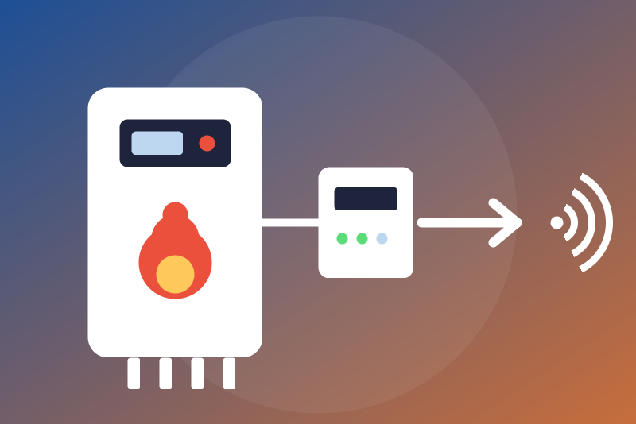

# Wolf ISM8 for Gladys Assistant

A [Gladys Assistant](https://gladysassistant.com) external integration for
Wolf heating systems through the **ISM8i** (or ISM8) module, on the local
network, without any cloud: boilers, heat pumps, direct and mixer circuits,
cascade, solar module, CWL ventilation and BM-2 control unit, as the ISM8i
reports them.

Unofficial, not affiliated with Wolf. **Never tested with a real ISM8i**: it
follows the ISM8 interface description published by Wolf and the
[wolf_ism8](https://github.com/marcschmiedchen/wolf_ism8) library (MIT) of the
Home Assistant integration
[home-assistant-wolf_ism8](https://github.com/marcschmiedchen/home-assistant-wolf_ism8).

## What it does

- **The ISM8i connects to Gladys**: it is a TCP client of the server typed in
  its web page. The integration starts a small receiver (the `ism8-link`
  sub-container) once the address of the ISM8i is saved, and Gladys publishes
  its port on the machine (the port is shown in the Configuration screen;
  type it in the ISM8i instead of 12004). Nothing listens before.
- **Values**: temperatures, power, states, programs and operating states,
  the last fault code; one Gladys device per Wolf element reported.
- **Settings**, behind an option off by default: hot water setpoint (20 °C
  to a ceiling of 65 °C at most) and heating and hot water programs of the
  direct and mixer circuits. The standby program (the stop) is never blocked.
- **Bounded**: 4 connections, one ISM8 session, frames of 2048 bytes, the
  sender checked by default.

The ISM8 protocol has no password: keep it on a trusted network. Read the
guide: [français](docs/fr.md), [English](docs/en.md) (network, the stop,
troubleshooting).

## Development

See [CLAUDE.md](CLAUDE.md) for the commands, the architecture and the rules,
and [TODO.md](TODO.md) for the status and the decisions.

## License

Apache-2.0 (see [LICENSE](LICENSE)); ported parts under MIT, see
[THIRD_PARTY_NOTICES.md](THIRD_PARTY_NOTICES.md).
